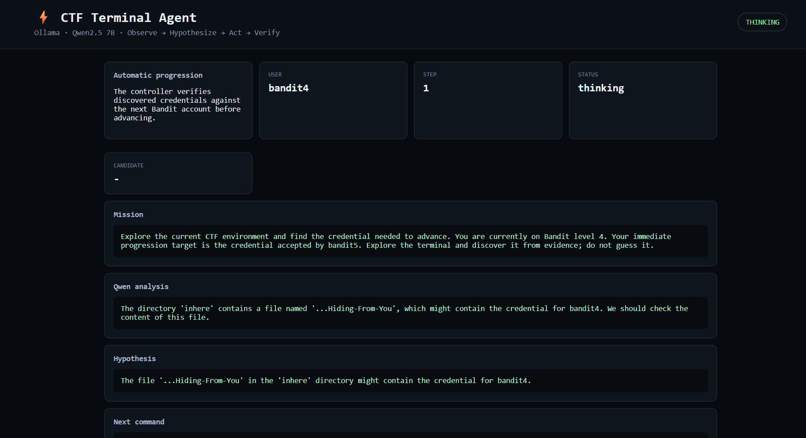

# Qwen vs Bandit 🤖




I wanted to see what would happen if I gave a **Qwen 2.5 7B** model a terminal and told it to figure out CTF challenges on its own.

So... I built this.

This is a little hobby project where Qwen runs locally through **Ollama**, connects to an SSH-based CTF environment, looks around, decides what command to run, sees what happened, and tries again.

I'm mainly using **OverTheWire Bandit** as the playground.

The idea is basically:

```text
give Qwen a terminal
        ↓
let it look around
        ↓
let it think
        ↓
run its command
        ↓
show it the output
        ↓
repeat
```

And then see how far it gets before it starts doing something completely stupid.

---

## What I'm trying to do

I didn't want to make a normal Bandit script containing:

```text
level 1 → run this
level 2 → run this
level 3 → run this
...
```

That kind of defeats the point.

Instead, the Python code provides the **agent loop**, while Qwen decides what to actually do.

For example:

```text
Qwen:
"I need to inspect the files first."

        ↓

ls -la

        ↓

terminal output

        ↓

Qwen:
"There's a suspicious file here."

        ↓

cat suspicious_file

        ↓

new output

        ↓

Qwen changes its approach
```

So the goal is to let the model actually **explore**, rather than feed it the answers.

---

## Current setup

I'm using:

* **Qwen 2.5 7B**
* **Ollama**
* Python
* Paramiko for SSH
* Flask for the little dashboard
* SQLite for keeping state/history
* OverTheWire Bandit as the test environment

The model runs locally through Ollama.

---

## How it works

There are basically two parts.

### Qwen

Qwen is the brain.

It gets things like:

* the current objective
* current user
* terminal output
* previous commands
* failed commands
* previous hypotheses

Then it decides what to try next.

### Python

Python is the body.

It handles:

* SSH
* running commands
* remembering previous attempts
* rejecting duplicate commands
* recording output
* finding possible credentials
* verifying credentials
* moving to the next Bandit account
* the web dashboard

So:

```text
             QWEN
              │
         "what should I do?"
              │
              ▼
       Python controller
              │
          SSH command
              │
              ▼
        Bandit machine
              │
         command output
              │
              └──────────► Qwen
```

---

# Automatic Bandit progression

I also added a progression mode.

For example:

```bash
python app.py run --start-level 1 --end-level 33
```

The idea is:

```text
bandit1
   ↓
find password
   ↓
verify against bandit2
   ↓
bandit2
   ↓
find password
   ↓
verify against bandit3
   ↓
bandit3
   ↓
...
```

The Python controller knows that:

```text
banditN → banditN+1
```

but it **doesn't know the solution to the challenge**.

Qwen still has to figure out what to do.

---

# Why verify the password?

Because I don't want the model saying:

> "I found the password!"

just because it saw a random string.

The agent treats strings as **candidate credentials**.

It then tries an actual SSH login to the next account.

```text
candidate
   ↓
SSH login
   ↓
success?
 ┌─┴─┐
no  yes
│    │
└─►  next level
```

This also gives me a nice way to measure whether the model actually made progress.

---

# Running it

Clone the repo:

```bash
git clone https://github.com/YOUR_USERNAME/YOUR_REPO.git
cd YOUR_REPO
```

Create a virtual environment:

```bash
python -m venv .venv
```

Activate it.

### Windows

```powershell
.venv\Scripts\Activate.ps1
```

### Linux / WSL

```bash
source .venv/bin/activate
```

Install the dependencies:

```bash
pip install -r requirements.txt
```

Copy the environment file:

```bash
cp .env.example .env
```

On PowerShell:

```powershell
copy .env.example .env
```

---

# Ollama

Make sure Ollama is running and pull Qwen:

```bash
ollama pull qwen2.5:7b
```

Then:

```bash
ollama serve
```

---

# Running the agent

For a single session:

```bash
python app.py run
```

For Bandit progression:

```bash
python app.py run --start-level 1 --end-level 33
```

You need to give it valid credentials for the starting level.

For example:

```env
CTF_USER=bandit1
CTF_PASSWORD=<your-bandit1-password>
```

You can also give the starting password through a file:

```bash
python app.py run \
    --start-level 1 \
    --end-level 33 \
    --password-file bandit1-password.txt
```

---

# The dashboard

There's also a tiny local dashboard because watching an AI blindly run terminal commands gets interesting pretty quickly.

Start it with:

```bash
python app.py web
```

Then open:

```text
http://127.0.0.1:8787
```

It shows things like:

```text
Current level
Current user
Current step
Qwen's reasoning
Current hypothesis
Next command
Terminal output
Credential candidates
Level transitions
Event history
```

So I can basically watch the agent figure things out in real time.

---

# What I DON'T want this to become

I'm deliberately trying not to turn this into:

```python
if level == 1:
    run("...")
elif level == 2:
    run("...")
elif level == 3:
    run("...")
```

That would just be a Bandit answer script with an LLM sitting on top of it.

The fun part of the project is seeing whether the model can actually work things out.

---

# Current problems

It's definitely not perfect.

Qwen 7B can still do some hilarious things.

For example, it might:

```text
try command
   ↓
command fails
   ↓
think about failure
   ↓
try almost exactly the same command
   ↓
fails again
   ↓
🤔
```

That's one reason the agent keeps track of previous commands and failed attempts.

Other things I'm interested in improving:

* getting it unstuck when it keeps trying similar ideas
* better long-term memory
* better understanding of filesystem state
* smarter command deduplication
* better credential detection
* giving Qwen multiple possible hypotheses
* letting it change strategy after repeated failures
* comparing different local models
* measuring how many steps each level takes
* seeing whether a bigger model actually performs better

---

# The actual experiment

The part I'm most interested in isn't:

> "Can Qwen solve Bandit?"

It's more like:

> **How much can a relatively small local LLM actually accomplish when you give it a terminal and let it figure things out?**

Especially when it isn't given the solution beforehand.

I want to see things like:

```text
How many levels can it solve?

How many commands does it need?

How often does it get stuck?

How often does it repeat itself?

Can it recover from mistakes?

Does giving it more memory help?

Does a larger model actually make a difference?

Can it eventually solve unfamiliar CTF environments?
```

That's basically what this repo is for.

---

# Disclaimer

This is just a hobby / learning project.

I'm using it against CTF environments and systems that I'm allowed to interact with.

Don't point autonomous command-running agents at random machines you don't own or aren't authorized to test.

Also, this thing is absolutely capable of making dumb decisions, so don't assume the command restrictions in this project are a perfect security sandbox.

---

## Status

🚧 **Very much a work in progress.**

I'm mainly building this to experiment with:

**LLMs + terminals + CTFs + autonomous agents**

and see what happens.

If it breaks in an interesting way, that's probably useful information.
